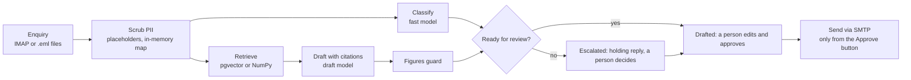

# inboxdraft

**AI-drafted email replies from your own documents. A person sends every email.**

[](https://github.com/danilablagorodniy37/inboxdraft/actions/workflows/ci.yml)
[](LICENSE)
[](pyproject.toml)

inboxdraft reads an enquiry from a shared inbox, finds the answer in the company's own documents and drafts a reply with the sources it used. A member of staff reads, edits and presses Send. Nothing leaves on its own, and that is a test in the repository, not a promise in the README.


[2-minute demo video](docs/demo.md) · [evaluation report](evals/report.md)

## Why

A small business, a clinic, a school or an accountancy practice answers the same thirty questions by email every day: what does it cost, what do I bring, when is it due, can I move my appointment. The answers are all in documents the firm already has, so the replies get written by hand in the evening, the prices in them drift from the price list, and some enquiries wait a day. inboxdraft turns that into a review queue: every enquiry arrives with a draft, the sources it came from and a confidence score, and a person decides.

## What it does differently

1. **Personal details never reach the model.** Names, email addresses, phone numbers, postcodes, street addresses, National Insurance numbers and UTRs are replaced with placeholders such as `[NAME_1]` before any text is embedded or sent to a model. The map back to the real values lives in memory for one request and is never written to the database or to logs. The review screen has a "What the model saw" panel so you can check.
2. **Every claim has a source.** The draft is written only from the retrieved sections of your documents and cites them as `[1]`, `[2]`. The reviewer sees the sections next to the draft; the markers are removed when the email is sent.
3. **No invented figures.** A deterministic guard checks every price, percentage, time and number of 10 or more in the draft against the sources and the enquiry. A draft with an unsupported figure is escalated, so an invented price never reaches a ready draft.
4. **It knows when to stop.** A fast classifier flags complaints, HMRC letters, refunds and requests for personal tax advice as "a person first". A draft below the confidence threshold, or a question the documents do not cover, becomes a holding reply and an escalation instead of a guess.
5. **No code path sends without a person.** `smtplib` is imported in one module and the sender is called from one function, the approve route. `tests/test_no_send_without_human.py` checks this statically with `ast` and dynamically by running the whole pipeline and the evals with a spy on the sender.
6. **Cost is visible.** Tokens and price per draft are shown on every enquiry and summed in the evaluation report.

## How it works



The whole pipeline is `src/inboxdraft/pipeline.py`, under 150 lines. Everything else is plumbing: ingest (`ingest.py`, `chunking.py`), the two model calls (`classify.py`, `draft.py`), the guard (`guard.py`), the review UI (`web/`) and the evaluation harness (`evals.py`).

## Results

Measured by `make evals` on the 50 synthetic enquiries in `evals/cases.jsonl` against the demo knowledge base, a fictional accountancy practice. The full table, per enquiry, is in `evals/report.md`.

| Metric | Result |
|---|---|
| Enquiry category classified correctly | [X] of 50 |
| Escalation decision correct (should a person look first) | [X] of 50, [N] missed |
| Ready drafts the judge would send without edits | [X]% |
| Ready drafts with every required fact (rule check) | [X]% |
| Unsupported figures caught by the guard / reaching a ready draft | [N] / 0 |
| Time per enquiry, p50 / p95 | [N] s / [N] s |
| Cost per enquiry (classify + draft) | about $[0.00X] |
| Emails sent during the run | 0 |

Models: `claude-sonnet-5-5` for drafts, `claude-haiku-5-5` for classification and as the judge, `BAAI/bge-small-en-v1.5` (local) for the index. Prices are configured values; see `.env.example`. The "send without edits" number comes from an LLM judge; `evals/labels.csv` lets a person label the first 20 drafts and the report shows the agreement.

The enquiries, the firm and the clients are synthetic. Real inboxes are messier: expect the escalation rate to go up and the unedited rate to go down until the knowledge base covers what people actually ask.

## Run it yourself

### Docker, with PostgreSQL + pgvector

```bash
git clone https://github.com/danilablagorodniy37/inboxdraft && cd inboxdraft
cp .env.example .env            # add ANTHROPIC_API_KEY, or leave it empty for the fake model
docker compose up --build
```

Open http://localhost:8000. The container indexes `knowledge/`, imports the 8 demo emails from `inbox/`, drafts replies and starts the review UI. Without an API key the drafts come from a rule-based fake model, which is enough to click through the flow.

### Local, with SQLite

```bash
python -m venv .venv && . .venv/bin/activate    # Windows: .venv\Scripts\activate
pip install -e ".[dev]"
cp .env.example .env
inboxdraft demo                                  # ingest + import + draft + serve on :8000
```

The first run downloads the embedding model (about 65 MB) into the fastembed cache.

### Your own documents and mailbox

1. Put Markdown, text, PDF or DOCX files into `knowledge/` and run `inboxdraft ingest`. Headings become the citation labels, so structure your documents with `##` sections.
2. Set `IMAP_*` in `.env` and run `inboxdraft import --imap` on a schedule (cron, a systemd timer, or the Import button in the UI). Or drop `.eml` files into `inbox/`.
3. Run `inboxdraft process`, then review at `inboxdraft serve`. Set `SMTP_*` to send; without it, approved replies are written to `data/outbox/` as `.eml` files.
4. Set `APP_PASSWORD` to protect the UI (HTTP basic auth, user `staff`) and `DEMO_MODE=false` to hide the badge.

### Commands

| Command | What it does |
|---|---|
| `inboxdraft ingest` | Index `KNOWLEDGE_DIR` (idempotent: unchanged files are skipped) |
| `inboxdraft import [--imap]` | Import `.eml` files from `INBOX_DIR`, and unseen IMAP messages with `--imap` |
| `inboxdraft process` | Draft replies for every new enquiry |
| `inboxdraft serve` | Review UI on http://127.0.0.1:8000 |
| `inboxdraft demo` | All of the above in one go |
| `inboxdraft evals` | Run the evaluation set, write `evals/report.md` |
| `inboxdraft status` | Show provider, index, database and counts |
| `inboxdraft reset --yes [--index-only]` | Drop tables (the index only, or everything) |

`make test`, `make lint`, `make evals` wrap the same commands.

## Configuration

Everything is an environment variable or a line in `.env`; `.env.example` lists them all. `.env` is git-ignored, CI runs `scripts/check_secrets.py` over every tracked file, and `make hooks` installs the same check as a pre-commit hook; switch on GitHub's push protection for your copy as well. The ones that matter:

| Variable | Default | Notes |
|---|---|---|
| `LLM_PROVIDER` | `auto` | `anthropic`, `openai`, `fake`; `auto` picks by which key is set |
| `DRAFT_MODEL` / `FAST_MODEL` | `claude-sonnet-5-5` / `claude-haiku-5-5` | Draft writer / classifier and judge |
| `EMBEDDINGS_PROVIDER` | `fastembed` | `fastembed` (local, no key), `openai`, `hashing` (tests) |
| `DATABASE_URL` | SQLite in `data/` | `postgresql+psycopg://...` for pgvector |
| `CONFIDENCE_THRESHOLD` | `0.6` | Drafts below it are escalated |
| `TOP_K` | `5` | Sections retrieved per enquiry |
| `FIRM_NAME`, `FIRM_SIGNATURE`, `REPLY_FROM` | demo firm | Used in prompts and outgoing mail |
| `ESCALATION_REPLY_BY` | `the end of the next working day` | Promise in the holding reply |
| `MODEL_PRICES` | see `config.py` | JSON, USD per million tokens, for the cost column |

Changing the embedding model changes the vector width: run `inboxdraft reset --yes --index-only` and `inboxdraft ingest` again.

## Evaluation

`evals/cases.jsonl` holds 50 enquiries with the expected category, whether a person must handle it, whether the documents cover it, the facts a correct reply must contain and a reference answer. `inboxdraft evals` runs them through the real pipeline and reports:

- category accuracy and escalation decisions, with **missed escalations** called out separately because they are the dangerous case;
- for ready drafts, a rule check (required facts present, forbidden claims absent) and a judge verdict from the fast model (`send_as_is`, `minor_edit`, `rewrite`) with any invented facts it spots;
- unsupported figures caught by the guard, and how many reached a ready draft (must be 0);
- p50 / p95 time and cost per enquiry at the configured prices.

Fill in `evals/labels.csv` with your own verdicts for the first 20 drafts and the report adds human-judge agreement. With `LLM_PROVIDER=fake` the harness still runs end to end; those numbers only prove the harness works.

## Project layout

```
src/inboxdraft/
  pipeline.py      scrub -> classify -> retrieve -> draft -> guard -> restore
  pii.py           placeholders and the in-memory map
  classify.py      category + "needs a person first" (fast model)
  retrieve.py      pgvector on PostgreSQL, NumPy on SQLite
  draft.py         reply with citations and confidence (draft model)
  guard.py         figures must appear in a source or the enquiry
  ingest.py        files -> sections -> embeddings
  evals.py         the harness and the report
  mail/            .eml and IMAP reader, importer, SMTP/outbox sender
  web/             FastAPI + HTMX review UI
knowledge/         demo documents (fictional accountancy practice)
inbox/             8 demo enquiries as .eml
evals/             cases.jsonl, labels.csv, report.md
tests/             pytest, no network and no keys needed
```

## What I would add for production

- A worker that polls IMAP and processes on a schedule, with retries and an alert when a model call fails.
- A per-day cost cap and a per-mailbox rate limit.
- Retention: delete processed enquiries after N days, keep only the audit line.
- A data processing agreement with the model provider and, for the strictest clients, an on-prem model behind the same `LLM` interface.
- Single sign-on in front of the review UI instead of basic auth.
- Growing `evals/cases.jsonl` from real anonymised enquiries, which is where the numbers start to mean something.

## Limitations

- The PII rules are regular expressions tuned for UK enquiries. They do not catch dates of birth, names in the middle of a sentence that are not the sender's, or non-UK phone formats; add rules in `pii.py` for your inbox.
- Retrieval is plain nearest-neighbour search over sections. A knowledge base of a few hundred pages is fine; thousands of documents want hybrid search and reranking.
- One language (English) and one mailbox per deployment.

## Author

Daniel Blago, Python and AI automation engineer, UK. [GitHub](https://github.com/danilablagorodniy37) · [Upwork](https://www.upwork.com/freelancers/~01cb77ac692f720f4e)

## Licence

MIT. The demo firm, its documents and the enquiries are fictional; any resemblance to a real business is coincidental.
