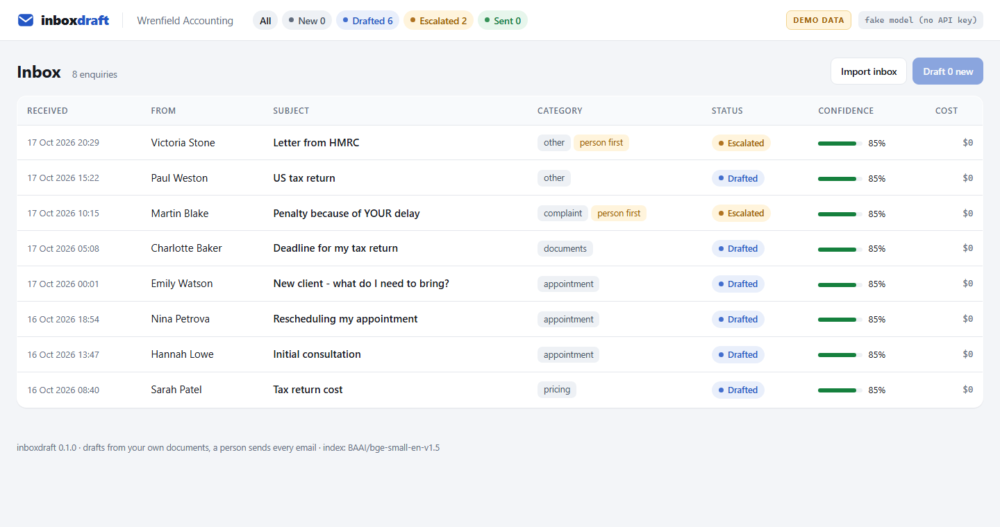
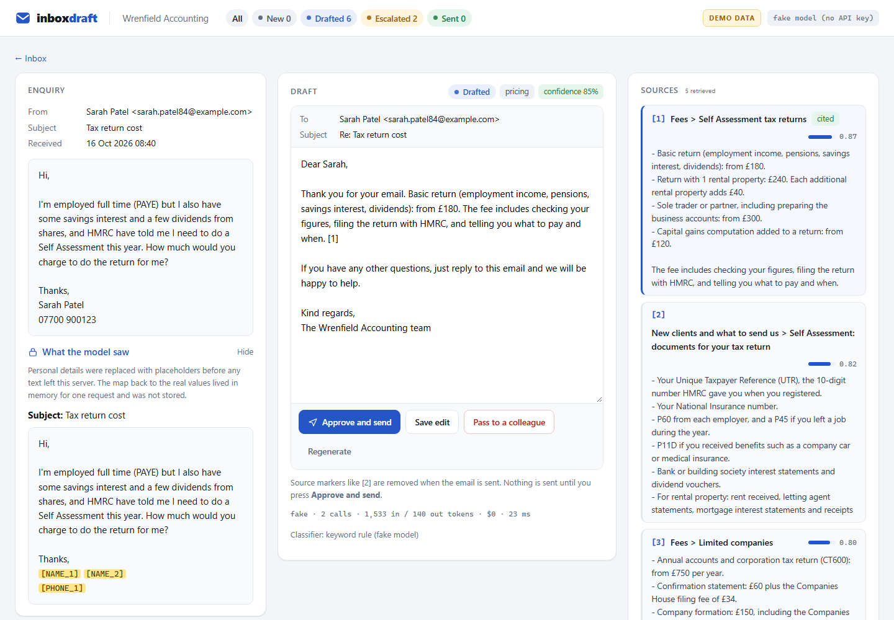

# Walkthrough

What you see after `make demo`. No key is needed: without one, a fake model drafts from templates, so the whole flow can be clicked through on a laptop. With a key, the same screens show real drafts, confidence and cost.

## The review queue

Every enquiry from the shared inbox arrives with a draft already written. The queue shows what each one is about, how confident the draft is, and which ones need a person before anything else.

## One enquiry

1. **A pricing question.** The draft quotes the fee list with a `[2]` citation, so the reviewer can check the figure against the source in one glance, edit a line and press **Approve and send**.
2. **What the model saw.** The same enquiry with the sender's name, phone and postcode replaced by placeholders. The real details are put back only into the finished draft.
3. **A question the documents do not cover.** It becomes a holding reply and an escalation, with notes for the reviewer instead of a guess.
4. **A complaint.** It is flagged "a person first" and never gets an auto-drafted answer.

Nothing is sent until a person presses the button. That is a test in the repository: `tests/test_no_send_without_human.py`.

## The numbers

`inboxdraft evals --offline` checks privacy and retrieval on 50 enquiries without a model; see [the offline report](../evals/offline-report.md). `make evals` with a key adds the model-graded numbers: classification, escalation, an LLM judge, cost per enquiry.
